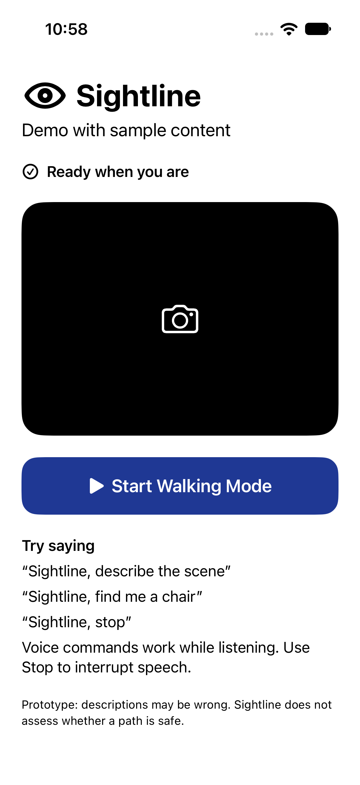
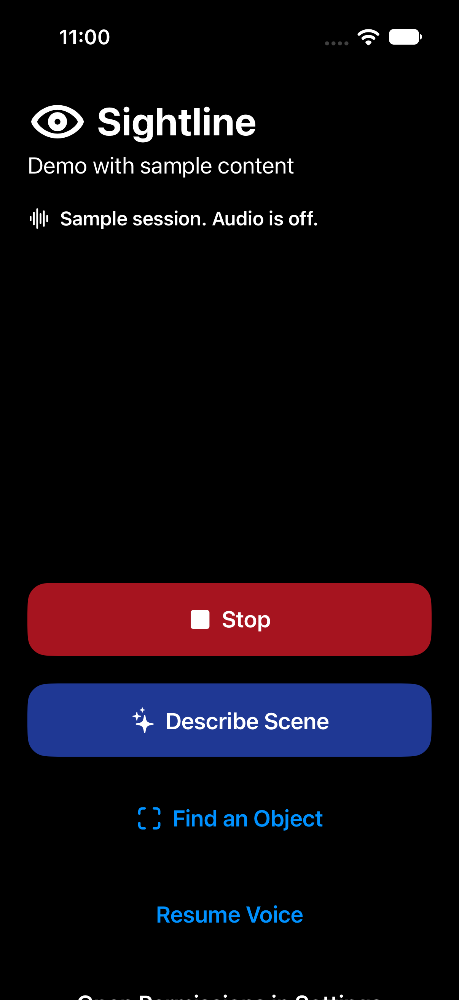
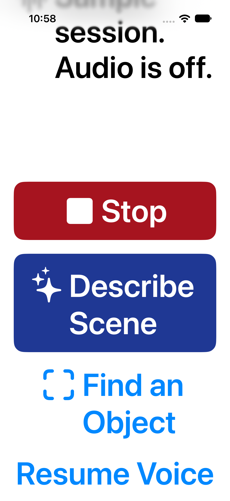

# Sightline interface screenshots

These iPhone 17 simulator captures use the Debug-only demo fixture. They show sample UI content with camera and microphone off; they are not evidence of real object recognition or cloud accuracy.

## Normal text

## Dark appearance

## Largest accessibility text

The screen scrolls so controls and descriptions remain reachable. The preview is shorter at accessibility text sizes to leave more room for controls.

